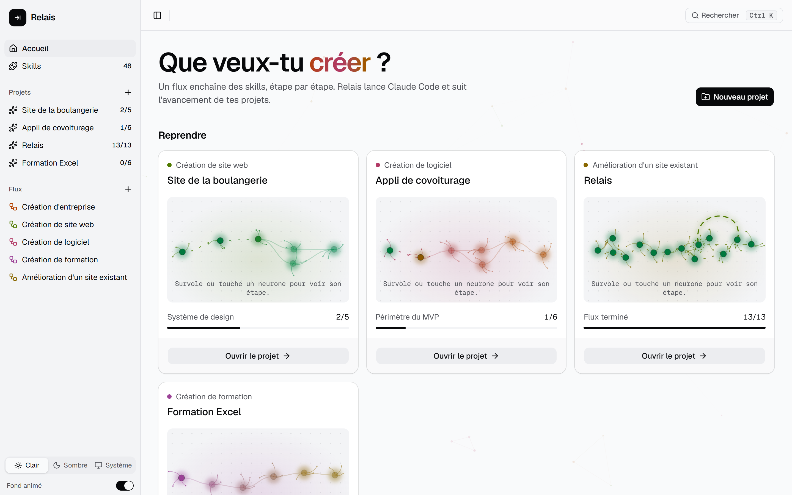
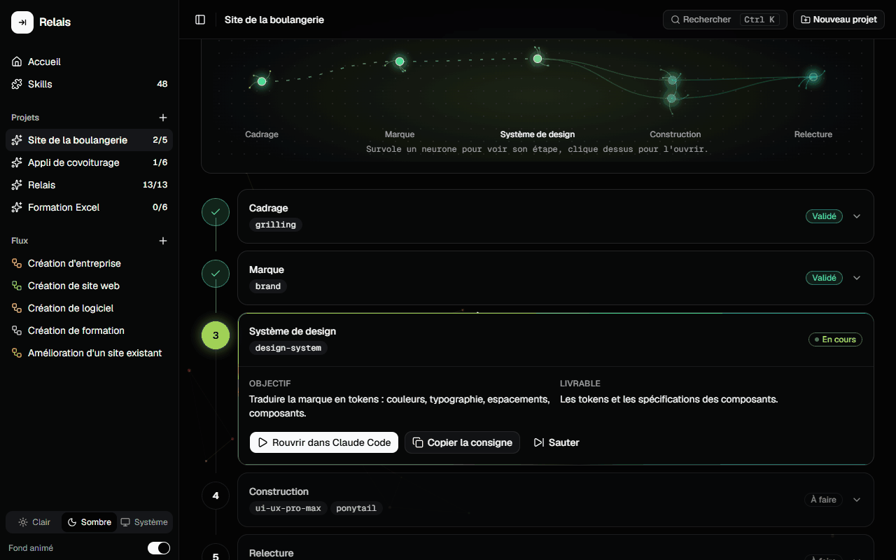
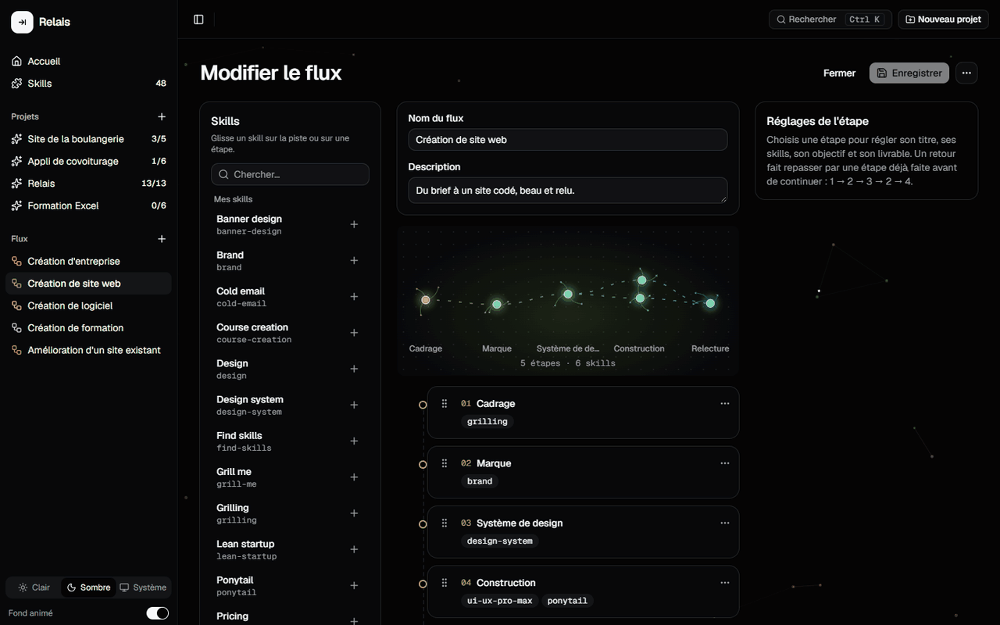
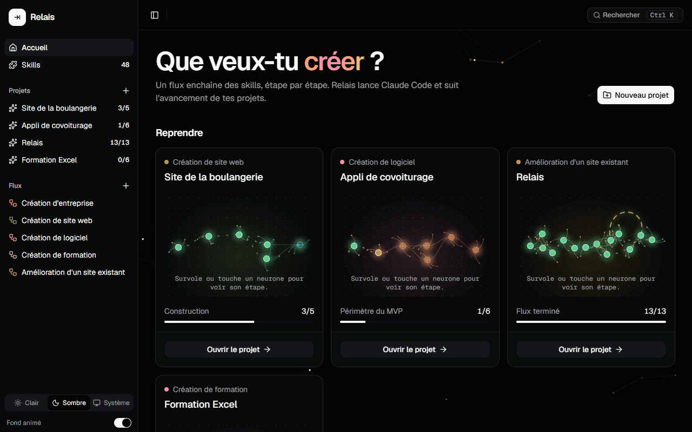
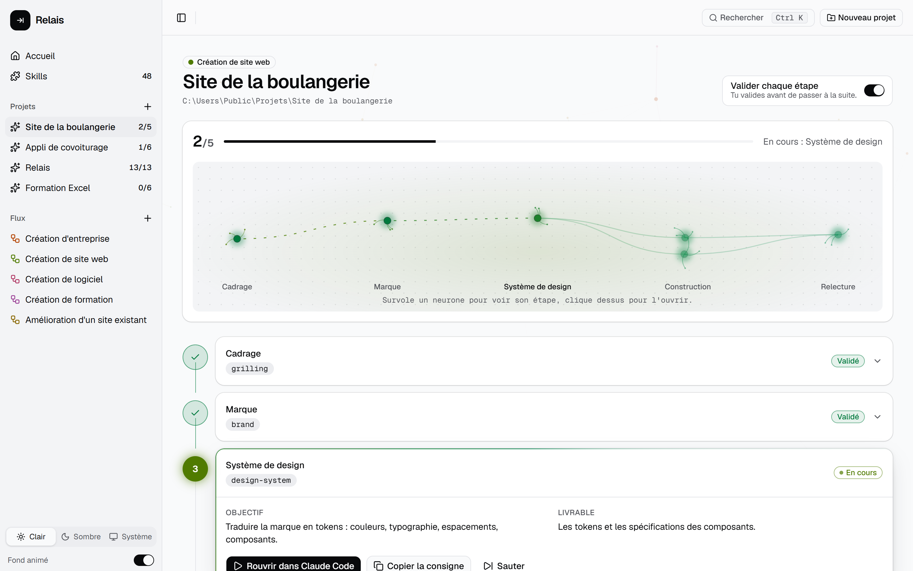
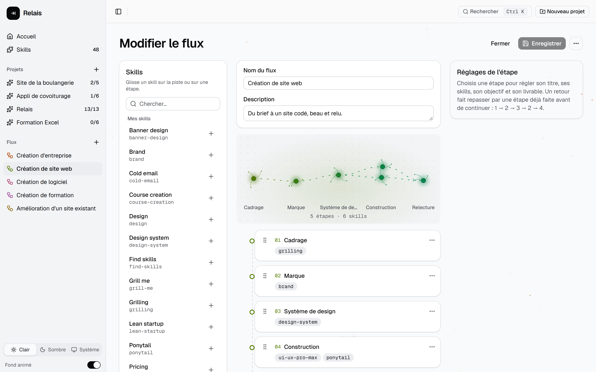
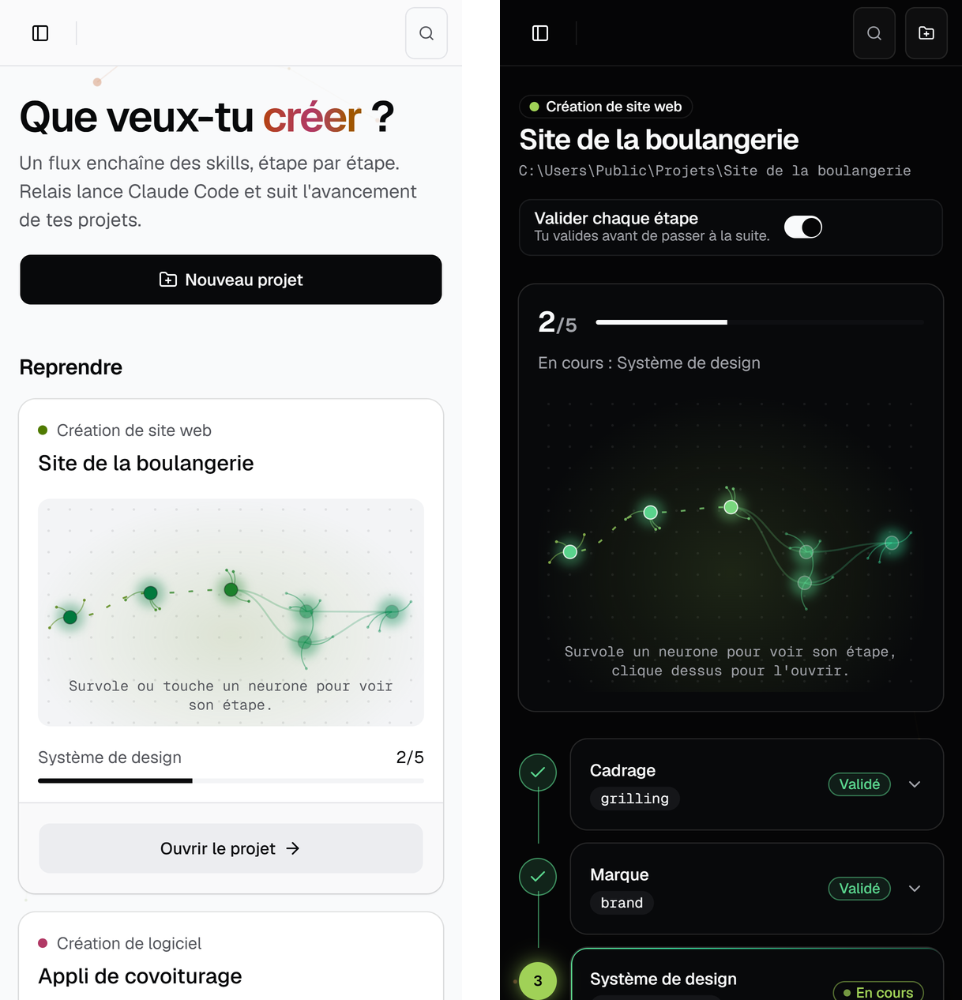

# Relais

[Français](README.md) · **English**

Relais chains Claude Code skills step by step and tracks how your projects are going.

It is a small local app. You pick a flow, for example "Website creation" or "Improving an existing site". Relais creates the project folder, then starts Claude Code at each step with the instructions and skills that step needs. Once a step has written its deliverable, you review it and move on to the next one.

The interface is in French for now. The screenshots below show what each part does.

<picture>
  <source media="(prefers-color-scheme: dark)" srcset="docs/accueil-sombre.png">
  
</picture>

## Screenshots and video

The 53-second walkthrough (no sound):

https://github.com/user-attachments/assets/193d83ed-3b17-43ea-a439-b44ba7193ae2

One step from start to finish: Claude Code writes the deliverable, the step moves to "À valider" (to review), you approve it and start the next one.



In the workshop, the "+" next to a skill creates a step. The network redraws itself and you set up the step on the right.



On the home page, a project's network animates when you hover over it. The theme follows Windows, and you can switch between light and dark at any time.



<details>
<summary>More screenshots (project view, workshop, mobile)</summary>

<picture>
  <source media="(prefers-color-scheme: dark)" srcset="docs/projet-sombre.png">
  
</picture>

<picture>
  <source media="(prefers-color-scheme: dark)" srcset="docs/atelier-sombre.png">
  
</picture>

<p align="center"></p>

</details>

The projects shown are examples made for the demo.

## What Relais does

A flow is a sequence of steps. Each step has a title, a goal, an expected deliverable and the skills to use. A loop sends you back to a step you already did, for example back to the redesign after the review. You build flows in the workshop: drag skills onto the track, set up the steps, and the network redraws on every change.

To start a step, Relais writes the instructions to `.relais/consigne.md` in the project folder, then opens Claude Code in a terminal on that folder. You can also copy the instructions and paste them yourself.

As soon as the step's deliverable exists in `livrables/`, the step moves to "À valider". Relais also keeps a readable `FLUX.md` up to date in the project. By default you review and approve each step, but you can also pick a single session that runs the whole flow.

Five flows come with it: starting a business, building a website, building software, creating a training course, and improving an existing site.

## Relais improved itself

I had Claude Code audit and improve Relais using its own "Improving an existing site" flow, in 13 steps: scoping, UX/UI audit, code audit, security audit, plan, fixes, design system, redesign, copy, simplification, review, back to the redesign, then a real-world check. Each step left its deliverable in [`livrables/`](livrables/) (in French), with before/after screenshots and measurements.

A few results from those deliverables:

- the command palette (Ctrl+K) used to blank the whole screen; it works now;
- 213 animations were looping on the home page, and none run at rest anymore;
- in the light theme, the contrast of the "En cours" badge went from 1.44:1 to 4.76:1;
- no page scrolls horizontally anymore, from 390 to 1500 px wide.

## Requirements

- Windows 10 or 11. Relais only runs on Windows for now: it starts from `Relais.bat` and opens the terminal with Windows Terminal (`wt.exe`), or `cmd` if that is missing.
- [Node.js](https://nodejs.org/) 20.19 or newer (22 LTS recommended), with npm.
- [Claude Code](https://docs.claude.com/en/docs/claude-code/overview), with the `claude` command available in the terminal.
- Some skills installed in Claude Code (see below).

## Install and run

```bat
git clone https://github.com/GeorgeOrson/relais.git Relais
cd Relais
Relais.bat
```

Without git, download the ZIP (the "Code" button, then "Download ZIP" on GitHub), unzip it and double-click `Relais.bat`.

On first launch, `Relais.bat` installs and builds the interface (`npm ci` then `npm run build` in `web/`), which takes about a minute. Relais then opens in your browser at `http://localhost:4748/`.

After that, double-clicking `Relais.bat` is enough. If Relais is already running, it opens the existing page.

New projects go to `Documents\Projets` by default, which you can change in the "Nouveau projet" dialog. You can also attach an existing folder.

## Skills

Relais ships no skills of its own. It lists the ones Claude Code already knows on your machine, in `~/.claude/skills` and in installed plugins. The "Skills" page lets you choose which ones show up in the workshop.

The bundled flows use the skills below. `code-review`, `security-review`, `simplify` and `run` come with Claude Code; the others are public skills or plugins that belong to their authors, which you install yourself.

| Flow | Skills |
|---|---|
| Starting a business | `grilling`, `lean-startup`, `startup-canvas`, `startup-financial-modeling`, `pricing`, `brand` |
| Building a website | `grilling`, `brand`, `design-system`, `ui-ux-pro-max`, `ponytail`, `code-review` |
| Building software | `grilling`, `lean-startup`, `ui-ux-pro-max`, `ponytail`, `code-review`, `security-review` |
| Creating a training course | `grilling`, `course-creation`, `pricing`, `slides`, `humanizer:humanizer` |
| Improving an existing site | `grilling`, `ui-ux-pro-max`, `run`, `code-review`, `security-review`, `ponytail`, `design-system`, `humanizer:humanizer`, `simplify` |

If one is missing, the step can't start and Relais offers "Trouver un skill": Claude Code opens to look for one that fits. You can also install it yourself, or change the flow in the workshop.

## Security

Relais only listens on `127.0.0.1`. Actions go through `POST` requests that require a Relais-specific header and a local origin. The server checks that paths stay inside the project folder, and the page refuses to be shown in a frame. Details are in the [security audit](livrables/04-audit-de-securite.md) (in French).

## Layout

```
Relais.bat        launcher (installs and builds the interface on first run)
server.js         local server: API, projects, instructions, starting Claude Code
skills.js         reads installed skills
flux/             bundled flows (JSON)
test.js           server tests
web/              interface (React, Vite, Tailwind, shadcn/ui)
livrables/        the 13 deliverables from Relais's improvement flow
```

## Development

```bat
node test.js                   :: server tests
cd web
npm run build                  :: rebuilds the interface into web\dist
npx tsc -b && npx eslint src   :: types and lint
```

The server serves `web/dist`. After changing `web/src`, rebuild and restart `Relais.bat`.

## Known limits

Relais only works on Windows and its interface is in French. Skill descriptions are shown as written in their `SKILL.md` files, often in English.

The [final check](livrables/13-verification-en-conditions-reelles.md) left a few open points: the "Validé" badge is at 4.39:1 in the light theme, a few targets are under 24 px, and adding a skill on mobile gives no visible feedback.

## License

[MIT](LICENSE)
