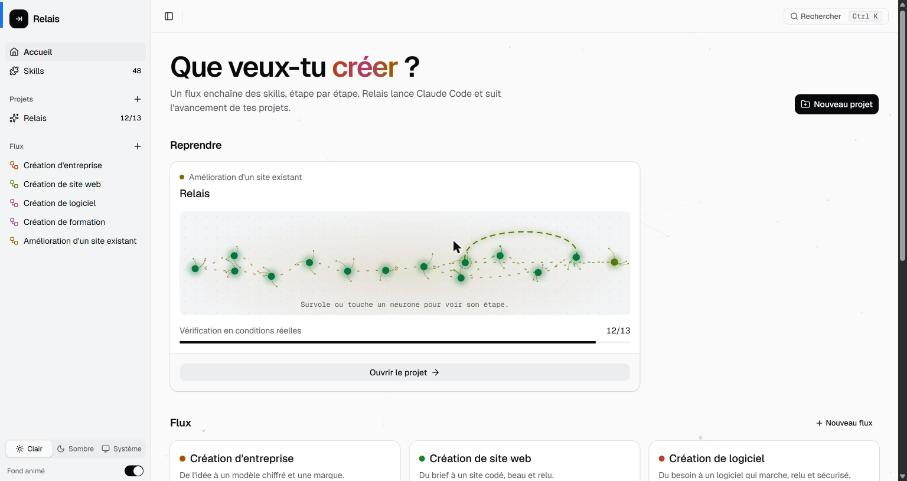
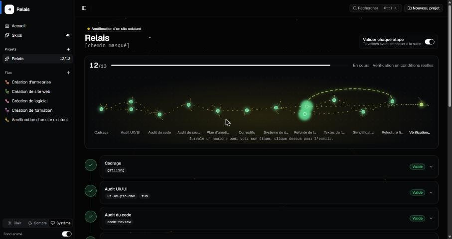

# Relais

**Enchaîne les skills de Claude Code, étape par étape, et suis l'avancement de tes projets.**

Relais est une petite application locale. Tu choisis un *flux* (par exemple « Création de site web » ou « Amélioration d'un site existant »), Relais crée le dossier du projet, puis lance Claude Code à chaque étape avec la bonne consigne et les bons skills. Quand une étape a écrit son livrable, tu la valides et tu passes à la suivante.





## Ce que fait Relais

- **Des flux réutilisables.** Un flux est une suite d'étapes. Chaque étape a un titre, un objectif, un livrable attendu et les skills à utiliser. Un *retour* fait repasser par une étape déjà faite (par exemple, revenir à la refonte après la relecture).
- **Un lancement en un clic.** Relais écrit la consigne de l'étape dans `.relais/consigne.md` (dans le dossier du projet), puis ouvre Claude Code dans un terminal sur ce dossier. Tu peux aussi copier la consigne et la coller toi-même.
- **Un suivi automatique.** Dès que le livrable de l'étape existe (dans `livrables/`), l'étape passe à « À valider ». Relais tient aussi à jour un `FLUX.md` lisible dans le projet.
- **Deux modes.** « Valider chaque étape » : tu relis entre chaque étape. Ou une seule session qui enchaîne tout le flux.
- **Un atelier pour créer tes flux.** Tu glisses des skills, tu règles les étapes et les retours, et le réseau se dessine en direct.

Cinq flux sont fournis : création d'entreprise, de site web, de logiciel, de formation, et amélioration d'un site existant.

## Relais s'est amélioré lui-même

Relais a été audité et amélioré avec son propre flux « Amélioration d'un site existant », en 13 étapes : cadrage, audit UX/UI, audit du code, audit de sécurité, plan, correctifs, système de design, refonte, textes, simplification, relecture, retour sur la refonte, puis vérification en conditions réelles. Chaque étape a laissé son livrable, avec captures et mesures avant/après, dans [`livrables/`](livrables/).

Quelques résultats tirés de ces livrables :

- la palette de commandes (Ctrl+K), qui vidait tout l'écran, fonctionne ;
- les 213 animations qui tournaient en boucle sur l'accueil sont à 0 au repos ;
- le badge « En cours » en thème clair est passé d'un contraste de 1,44:1 à 4,76:1 ;
- plus aucun défilement horizontal de 390 à 1500 px de large.

## Prérequis

- **Windows 10 ou 11.** Pour l'instant, Relais ne tourne que sous Windows : lancement par `Relais.bat`, ouverture du terminal par Windows Terminal (`wt.exe`), sinon par `cmd`.
- **[Node.js](https://nodejs.org/)** 20.19 ou plus récent (22 LTS conseillé), avec npm.
- **[Claude Code](https://docs.claude.com/en/docs/claude-code/overview)** installé, avec la commande `claude` disponible dans le terminal.
- **Des skills installés** dans Claude Code (voir plus bas).

## Installation et lancement

```bat
git clone <adresse-du-depot> Relais
cd Relais
Relais.bat
```

Au premier lancement, `Relais.bat` installe et compile l'interface (`npm ci` puis `npm run build` dans `web/`), ce qui prend environ une minute. Relais s'ouvre ensuite dans ton navigateur sur `http://localhost:4748/`.

Par la suite, il suffit de double-cliquer sur `Relais.bat`. Si Relais tourne déjà, la page existante s'ouvre.

Les nouveaux projets sont créés par défaut dans `Documents\Projets` (modifiable dans la boîte « Nouveau projet »). On peut aussi rattacher un dossier existant.

## Les skills

Relais **ne fournit aucun skill**. Il liste ceux que Claude Code connaît déjà sur ta machine : `~/.claude/skills` et les plugins installés. La page « Skills » permet de choisir lesquels apparaissent dans l'atelier.

Les flux fournis citent des skills publics, propriété de leurs auteurs (par exemple `grilling`, `ui-ux-pro-max`, `ponytail`). Si un skill manque chez toi, l'étape ne peut pas être lancée, et Relais propose « Trouver un skill » : Claude Code s'ouvre pour en chercher un adapté. Tu peux aussi l'installer toi-même, ou modifier le flux dans l'atelier.

## Sécurité

Relais écoute seulement sur `127.0.0.1`. Les actions passent par des requêtes `POST` qui exigent un en-tête propre à Relais et une origine locale. Les chemins sont vérifiés pour ne jamais sortir du dossier du projet, et la page refuse d'être affichée dans un cadre. Le détail est dans l'[audit de sécurité](livrables/04-audit-de-securite.md).

## Structure

```
Relais.bat        lancement (installe et compile l'interface au premier démarrage)
server.js         serveur local : API, projets, consignes, ouverture de Claude Code
skills.js         lecture des skills installés
flux/             les flux fournis (JSON)
test.js           tests du serveur
web/              interface (React, Vite, Tailwind, shadcn/ui)
livrables/        les 13 livrables du flux d'amélioration de Relais
```

## Développement

```bat
node test.js                   :: tests du serveur
cd web
npm run build                  :: recompile l'interface dans web\dist
npx tsc -b && npx eslint src   :: types et lint
```

Le serveur sert `web/dist`. Après une modification de `web/src`, recompile, puis relance `Relais.bat`.

## Limites connues

- Windows uniquement, interface en français.
- Les descriptions des skills s'affichent telles qu'elles sont écrites dans leurs fichiers `SKILL.md`, souvent en anglais.
- Les derniers points relevés par la [vérification finale](livrables/13-verification-en-conditions-reelles.md) : badge « Validé » à 4,39:1 en thème clair, quelques petites cibles, retour discret après l'ajout d'un skill sur mobile.

## Licence

[MIT](LICENSE)
