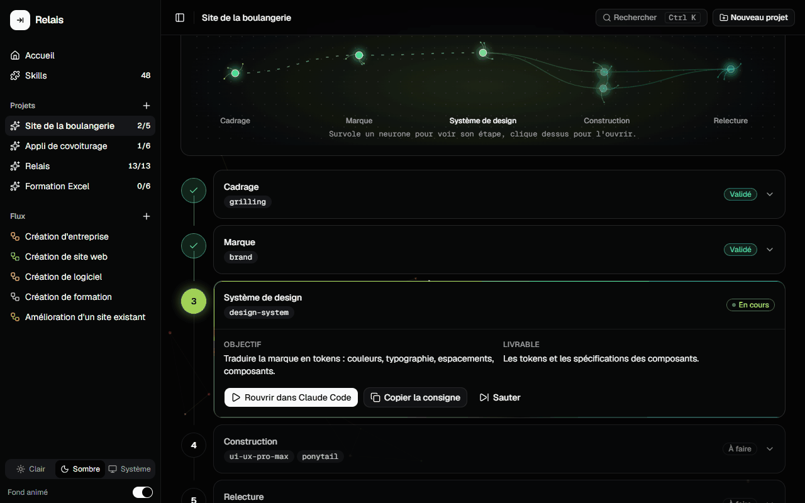
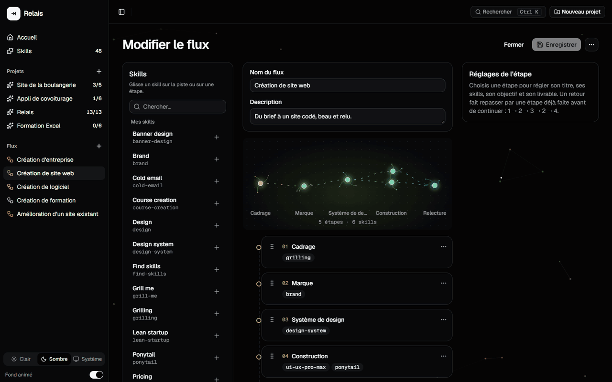
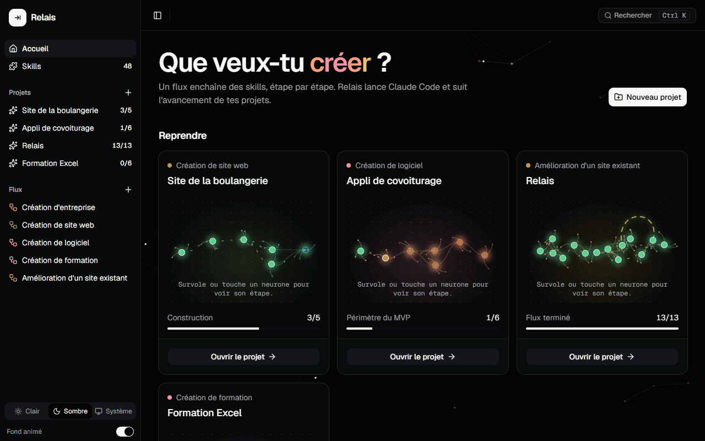
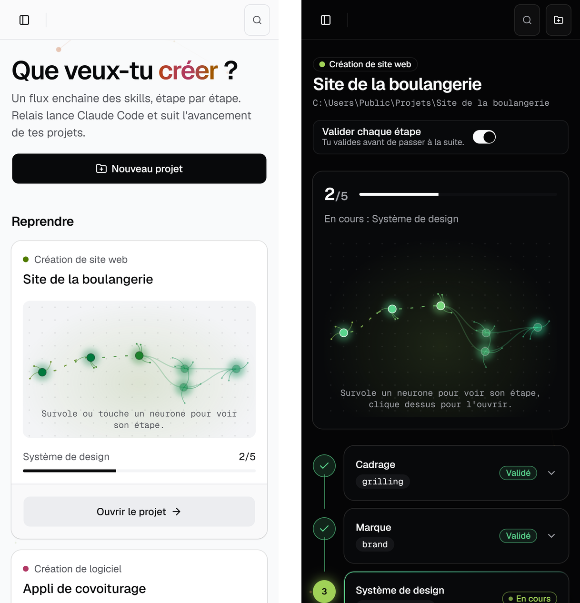

# Relais

Relais enchaîne les skills de Claude Code étape par étape et suit l'avancement de tes projets.

C'est une petite application locale. Tu choisis un flux, par exemple « Création de site web » ou « Amélioration d'un site existant ». Relais crée le dossier du projet, puis lance Claude Code à chaque étape avec la consigne et les skills qui vont avec. Quand une étape a écrit son livrable, tu la valides et tu passes à la suivante.

<picture>
  <source media="(prefers-color-scheme: dark)" srcset="docs/accueil-sombre.png">
  
</picture>

## En images

La présentation en vidéo (53 secondes, sans son) :

https://github.com/user-attachments/assets/193d83ed-3b17-43ea-a439-b44ba7193ae2

Une étape de bout en bout : Claude Code écrit le livrable, l'étape passe à « À valider », tu la valides et tu lances la suivante.



Dans l'atelier, le « + » d'un skill crée une étape. Le réseau se redessine et tu règles l'étape à droite.



Sur l'accueil, le réseau d'un projet s'anime quand tu le survoles. Le thème suit Windows, et tu peux passer en clair ou en sombre à tout moment.



<details>
<summary>Autres captures (suivi d'un projet, atelier, mobile)</summary>

<picture>
  <source media="(prefers-color-scheme: dark)" srcset="docs/projet-sombre.png">
  
</picture>

<picture>
  <source media="(prefers-color-scheme: dark)" srcset="docs/atelier-sombre.png">
  
</picture>

<p align="center"></p>

</details>

Les projets montrés ici sont des exemples créés pour la démonstration.

## Ce que fait Relais

Un flux est une suite d'étapes. Chaque étape a un titre, un objectif, un livrable attendu et les skills à utiliser. Un retour fait repasser par une étape déjà faite, par exemple revenir à la refonte après la relecture. Les flux se créent dans l'atelier : tu glisses des skills sur la piste, tu règles les étapes, et le réseau se redessine à chaque changement.

Pour lancer une étape, Relais écrit la consigne dans `.relais/consigne.md`, dans le dossier du projet, puis ouvre Claude Code dans un terminal sur ce dossier. Tu peux aussi copier la consigne et la coller toi-même.

Dès que le livrable de l'étape existe dans `livrables/`, l'étape passe à « À valider ». Relais tient aussi à jour un `FLUX.md` lisible dans le projet. Par défaut, tu relis et valides chaque étape. Tu peux aussi choisir une seule session qui enchaîne tout le flux.

Cinq flux sont fournis : création d'entreprise, de site web, de logiciel, de formation, et amélioration d'un site existant.

## Relais s'est amélioré lui-même

J'ai fait auditer et améliorer Relais par Claude Code, avec son propre flux « Amélioration d'un site existant », en 13 étapes : cadrage, audit UX/UI, audit du code, audit de sécurité, plan, correctifs, système de design, refonte, textes, simplification, relecture, retour sur la refonte, puis vérification en conditions réelles. Chaque étape a laissé son livrable dans [`livrables/`](livrables/), avec captures et mesures avant/après.

Quelques résultats tirés de ces livrables :

- la palette de commandes (Ctrl+K) vidait tout l'écran ; elle fonctionne ;
- 213 animations tournaient en boucle sur l'accueil, il n'y en a plus aucune au repos ;
- en thème clair, le contraste du badge « En cours » est passé de 1,44:1 à 4,76:1 ;
- aucune page ne défile plus à l'horizontale, de 390 à 1500 px de large.

## Prérequis

- Windows 10 ou 11. Pour l'instant, Relais ne tourne que sous Windows : il se lance par `Relais.bat` et ouvre le terminal avec Windows Terminal (`wt.exe`), ou `cmd` à défaut.
- [Node.js](https://nodejs.org/) 20.19 ou plus récent (22 LTS conseillé), avec npm.
- [Claude Code](https://docs.claude.com/en/docs/claude-code/overview), avec la commande `claude` disponible dans le terminal.
- Des skills installés dans Claude Code (voir plus bas).

## Installation et lancement

```bat
git clone https://github.com/GeorgeOrson/relais.git Relais
cd Relais
Relais.bat
```

Sans git, tu peux aussi télécharger le ZIP (bouton « Code » puis « Download ZIP » sur GitHub), le décompresser, puis double-cliquer sur `Relais.bat`.

Au premier lancement, `Relais.bat` installe et compile l'interface (`npm ci` puis `npm run build` dans `web/`), ce qui prend environ une minute. Relais s'ouvre ensuite dans ton navigateur sur `http://localhost:4748/`.

Ensuite, un double-clic sur `Relais.bat` suffit. Si Relais tourne déjà, il ouvre la page existante.

Les nouveaux projets vont par défaut dans `Documents\Projets`, ce que tu peux changer dans la boîte « Nouveau projet ». Tu peux aussi rattacher un dossier existant.

## Les skills

Relais ne fournit aucun skill. Il liste ceux que Claude Code connaît déjà sur ta machine, dans `~/.claude/skills` et dans les plugins installés. La page « Skills » permet de choisir lesquels apparaissent dans l'atelier.

Les flux fournis utilisent les skills suivants. `code-review`, `security-review`, `simplify` et `run` sont fournis avec Claude Code ; les autres sont des skills ou des plugins publics qui appartiennent à leurs auteurs, à installer de ton côté.

| Flux | Skills |
|---|---|
| Création d'entreprise | `grilling`, `lean-startup`, `startup-canvas`, `startup-financial-modeling`, `pricing`, `brand` |
| Création de site web | `grilling`, `brand`, `design-system`, `ui-ux-pro-max`, `ponytail`, `code-review` |
| Création de logiciel | `grilling`, `lean-startup`, `ui-ux-pro-max`, `ponytail`, `code-review`, `security-review` |
| Création de formation | `grilling`, `course-creation`, `pricing`, `slides`, `humanizer:humanizer` |
| Amélioration d'un site existant | `grilling`, `ui-ux-pro-max`, `run`, `code-review`, `security-review`, `ponytail`, `design-system`, `humanizer:humanizer`, `simplify` |

Si l'un d'eux manque chez toi, l'étape ne peut pas être lancée et Relais propose « Trouver un skill » : Claude Code s'ouvre pour en chercher un qui convient. Tu peux aussi l'installer toi-même, ou modifier le flux dans l'atelier.

## Sécurité

Relais écoute seulement sur `127.0.0.1`. Les actions passent par des requêtes `POST` qui exigent un en-tête propre à Relais et une origine locale. Le serveur vérifie que les chemins restent dans le dossier du projet, et la page refuse d'être affichée dans un cadre. Le détail est dans l'[audit de sécurité](livrables/04-audit-de-securite.md).

## Structure

```
Relais.bat        lancement (installe et compile l'interface au premier démarrage)
server.js         serveur local : API, projets, consignes, ouverture de Claude Code
skills.js         lecture des skills installés
flux/             les flux fournis (JSON)
test.js           tests du serveur
web/              interface (React, Vite, Tailwind, shadcn/ui)
livrables/        les 13 livrables du flux d'amélioration de Relais
```

## Développement

```bat
node test.js                   :: tests du serveur
cd web
npm run build                  :: recompile l'interface dans web\dist
npx tsc -b && npx eslint src   :: types et lint
```

Le serveur sert `web/dist`. Après une modification de `web/src`, recompile puis relance `Relais.bat`.

## Limites connues

Relais ne marche que sous Windows et son interface est en français. Les descriptions des skills s'affichent telles qu'elles sont écrites dans leurs fichiers `SKILL.md`, souvent en anglais.

La [vérification finale](livrables/13-verification-en-conditions-reelles.md) a laissé quelques points ouverts : le badge « Validé » est à 4,39:1 en thème clair, quelques cibles font moins de 24 px, et l'ajout d'un skill sur mobile ne donne pas de retour visible.

## Licence

[MIT](LICENSE)
